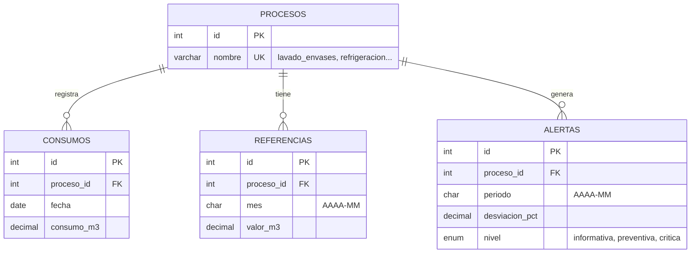

# Modelo entidad-relación

Base de datos `agua_cocacola` (MySQL). Fuente: `sql/schema.sql`. GitHub dibuja el diagrama automáticamente.

## Restricciones

| Tabla | Restricción | Para qué |
| --- | --- | --- |
| procesos | `nombre` único | Un solo registro por proceso |
| consumos | único (`proceso_id`, `fecha`) | HU-09: no guardar dos veces el mismo registro |
| referencias | único (`proceso_id`, `mes`) | Una sola referencia por proceso y mes |

La tabla `alertas` se llena en la HU-05 (Sprint 3).
